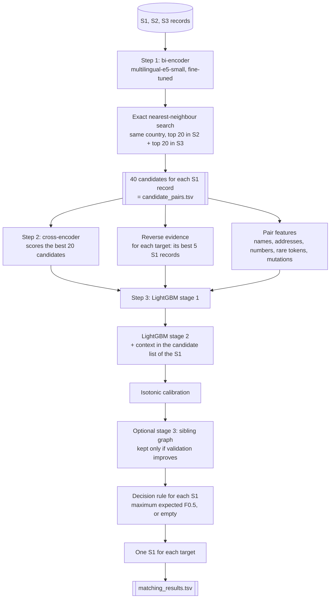
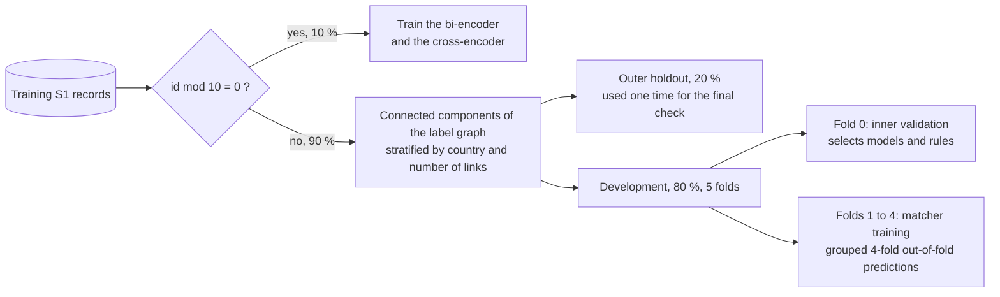
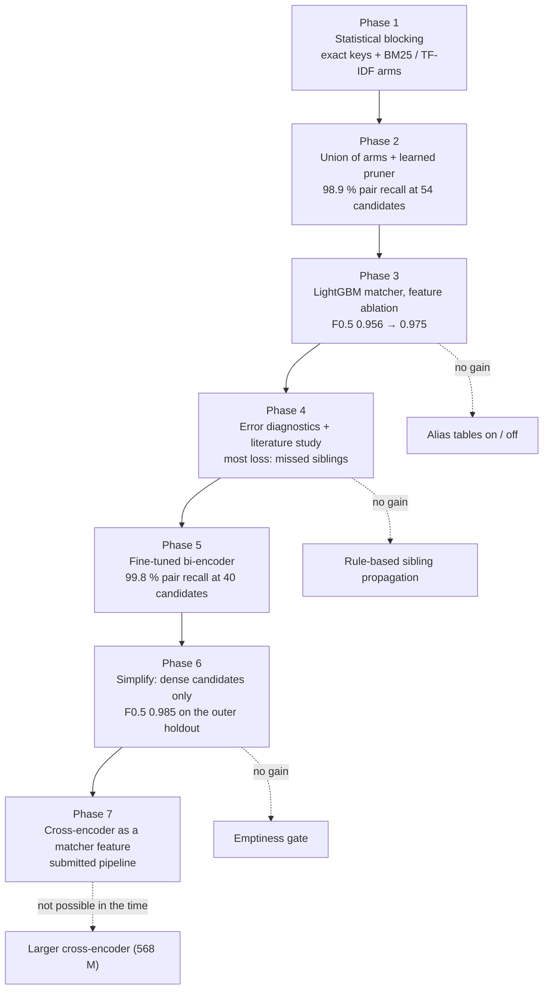
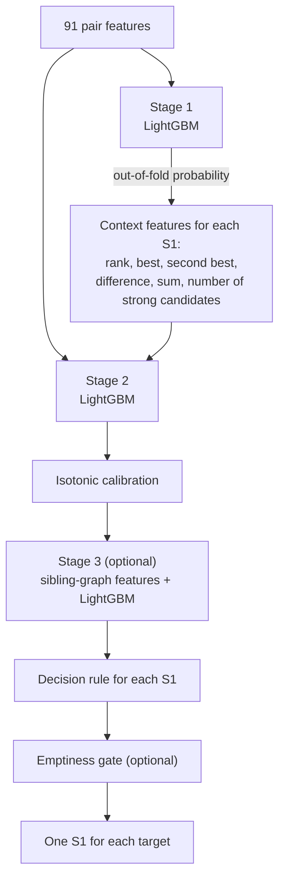

# ML Challenge 2026: Business Entity Resolution Solution

**Team Name:** COD-i  
**Team Members:** Vedant Singh, Kaustuk Pratap Singh  
**Submission Date:** 28 September 2026

**Terms in this document**

| Term | Meaning |
|---|---|
| S1 record | A record of Source 1 (the reference source). |
| Target | A record of Source 2 or Source 3. |
| Link | A true match between an S1 record and a target. |
| Candidate | A target that the blocking stage gives to the matcher for one S1 record. |
| Singleton | An S1 record with no link. |
| Sibling | One of two or more targets that link to the same S1 record. |
| Pair recall | The part of all links that are in the candidate set. |
| Complete S1 | An S1 record for which all its links are in the candidate set. |

---

## 1. Executive Summary

Our pipeline has three steps. A fine-tuned multilingual bi-encoder finds 40 candidates for each S1 record. A
cross-encoder then reads each S1 record together with its best 20 candidates and gives a match score. A LightGBM
matcher then uses 91 features to make the decision. The features are string similarity, rare tokens, numbers, the
two neural scores and reverse evidence. The decision rule maximises the expected F0.5 of each S1 record.

The key result is in the blocking stage. One small learned model (118 million parameters, MIT licence) replaced a
system of 12 statistical retrieval arms. It keeps 99.8 % of the links with 40 candidates for each S1 record.
The submission has a score of 0.987 on our outer holdout and **0.9829** on the public leaderboard.

---

## 2. Methodology

### 2.1 Problem Analysis

We examined the data before we made a model. These are the facts that controlled the design.

**Size**

| | Source 1 | Source 2 | Source 3 |
|---|---|---|---|
| Training records | 2,206,821 | 5,034,616 | 5,285,603 |
| Test records | 1,732,544 | 4,887,273 | 5,082,316 |

- The training labels contain approximately 7.6 million links.
- Approximately 94 % of the S1 records have one or more links. An S1 record with links has 3.7 links on average.
- Approximately 6 % of the S1 records are singletons.
- The test data contains three countries: India (809,986 S1 records), US (663,106) and France (259,452). The
  training data contains only India and US.

**Structure of the labels**

- A target links to one S1 record at most. We found no target with two S1 records in the training labels.
- Thus each group of linked records is a star: one S1 record in the centre and its targets around it.
- The siblings of one S1 record frequently look like each other (the same business in Source 2 and Source 3).

**Noise**

- True links have noise edits: abbreviations, typographical errors, changed word order, digits that are divided or
  dropped, numbers written as words, legal forms in different styles, transliteration between scripts.
- The hardest wrong candidates are near-copies. A near-copy is almost the same as a true target, but one field
  has a change: the house number, the legal form (Pvt Ltd / LLP) or the first word of the name.
- Thus a model must be tolerant of noise, but it must see one small change. These two properties are in conflict.
- Some targets have no address. Some records use a non-Latin script (for example Devanagari).
- Text normalisation is very important. Raw tokens gave 75 % pair recall in our first retrieval test. Normalised
  tokens gave 92 % with the same number of candidates.
- French records are not translated between the sources. They differ by abbreviations (`R` for `rue`, `IMP`,
  `BD`), as the Indian and US records do.

**Metric**

- The metric is the macro average of F0.5 for each S1 record. Precision has twice the weight of recall.
- A singleton has a score of 1 only if the prediction is empty. One wrong match for a singleton gives 0.
- A missed sibling decreases the score of one S1 record only by a small quantity. A wrong match in a short list
  decreases it more.

**Risk: a country that is not in the training data**

- France is only in the test data. We did a test: we fitted retrieval statistics on one country and searched in the
  other. The pair recall at 100 candidates decreased from 0.936 to 0.897 for India.
- Thus the pipeline does not use the country as a feature. It uses the country only to divide the search space.
  An S1 record is compared only with targets that have the same country label. The label list comes from the data.

### 2.2 Solution Strategy

**Approach Type:** Hybrid — learned blocking (bi-encoder) + cross-encoder + gradient-boosted classifier with a
set-level decision rule.

**Core Innovation:**

1. *Learned blocking.* We fine-tuned a small bi-encoder on 10 % of the training S1 records. With only 40
   candidates, it finds all the links of 99.3 % of the S1 records. Our best statistical system needed 54 candidates and found
   all the links of only 96.6 % of the S1 records.
2. *Free reverse evidence.* The cosine score is symmetric. Thus the forward candidate lists also tell us, for
   each target, which S1 records are its best matches. This is an important matcher feature, and it costs one
   group-by operation.
3. *One training split for all neural models.* The bi-encoder and the cross-encoder train only on S1 records with
   `id mod 10 = 0`. The matcher never uses these records. Thus all neural scores that the matcher sees are
   out-of-sample scores, and stacking is safe without cross-fitting.

**The final pipeline**



**How we measured (validation design)**

All decisions use this design. It prevents leakage and it gives scores that agree with the leaderboard.



- We divide by connected component. An S1 record and all its targets are always in the same part.
- An automatic audit makes sure that no component is in two parts. The audit found zero such components.
- Record IDs and the file order contain no information about the links (we tested this).
- Each sampled S1 record searches the full target set of its country. Thus the number of wrong candidates is the
  same as in the test.
- All statistics that do not use labels (token frequencies, name frequencies) come from the split that is searched.
  For the test data they come from the test records. This is necessary because France has no training records.

### 2.3 The path to the final pipeline

This section gives the sequence of our work: what we tried, what we measured and why we changed direction.
All scores are from our own splits, unless the text says "leaderboard".



#### Phase 1 — Statistical blocking

We started with methods that need no training. We wrote an experiment protocol first: each experiment had one
question, and each result went into a registry file with the same metrics.

*Tools.* Hashed sparse count matrices (2^25 columns) for each text view. BM25 and TF-IDF retrieval for each
country and each target source. Exact-key joins with a limit of 50 records for each key.

*Text views.* Each record has these views:

- normalised text (Unicode normalisation, transliteration to Latin, lower case);
- canonical legal forms and street types;
- name words without legal forms;
- phonetic tokens (Metaphone);
- numbers and alphanumeric tokens;
- character 3-grams and 4-grams.

*Results on inner validation (6,000 S1 records).* "K" is the number of candidates for each target source.

| Experiment | Candidates for each S1 | Pair recall | Complete S1 |
|---|---|---|---|
| Exact key: normalised name | 4.4 | 0.267 | 0.046 |
| Exact key: sorted core name | 5.9 | 0.442 | 0.135 |
| BM25, raw tokens, K = 5 | 10 | 0.749 | 0.410 |
| BM25, normalised tokens, K = 5 | 10 | 0.918 | 0.764 |
| BM25, normalised tokens, K = 50 | 100 | 0.961 | 0.884 |
| BM25, name only, K = 50 | 99 | 0.713 | 0.447 |
| BM25, address only, K = 50 | 100 | 0.894 | 0.721 |
| TF-IDF, character 3-grams of the name + address words, K = 50 | 100 | 0.970 | 0.914 |
| Reverse search (each target finds its best 5 S1 records) | 20 | 0.962 | 0.886 |
| Two-hop (S2 ↔ S3 neighbours of the best 2 candidates), K = 10 | 10 | 0.853 | 0.660 |

*What we learned.*

- Normalisation gave the largest gain: +17 points of pair recall at 10 candidates.
- The name and the address are both necessary. Each field alone is much worse.
- Alias tables (for example `blvd` → `boulevard`) made no difference: ±0.05 points. BM25 gives a low weight to
  frequent tokens, thus their spelling is not important.
- A more strict limit for frequent tokens decreased the recall. A limit of 2 % of the records was better than 0.5 %.
- The reverse search is strong. A target has one S1 record at most, thus "the best S1 record of this target" is a
  natural question. It gave 96.2 % pair recall with only 20 candidates.
- One arm alone stops near 97 %. More candidates from the same arm give little.

#### Phase 2 — Union of arms and a learned pruner

*Greedy union.* We added arms one at a time. At each step we selected the arm that added the most new links for
each added candidate. The result was a union of 12 arms: 3 exact keys, 6 BM25 arms, the two-hop arm, an arm for
targets without address and the reverse arm.

*Learned pruner.* The union gives each S1 record the same number of candidates from each arm. A small LightGBM
model then gave a score to each candidate in a wide pool. The pool had all arms at K = 50, which is 434 candidates
for each S1 record.
The model used only retrieval evidence: scores, ranks and the shape of the score curve. One threshold then kept
few candidates for clear S1 records and more candidates for ambiguous S1 records.

| Blocker (inner validation) | Candidates for each S1 | Pair recall | Complete S1 |
|---|---|---|---|
| Greedy union, small | 23.9 | 0.9702 | 0.9079 |
| Greedy union, medium | 42.0 | 0.9853 | 0.9543 |
| Greedy union, best | 53.6 | 0.9891 | 0.9658 |
| Learned pruner | 15.6 | 0.9858 | 0.9559 |
| Learned pruner | 26.1 | 0.9888 | 0.9653 |
| Learned pruner | 48.7 | 0.9907 | 0.9710 |
| Learned pruner | 93.3 | 0.9923 | 0.9756 |
| Wide pool (upper limit) | 434 | 0.995 | — |

*What we learned.* The pruner was better than the union at each size. It gave the recall of the best union with
half of the candidates. But the last 0.5 % of the links stayed out of reach, and the 12 arms were slow:
each BM25 arm needs approximately 4 CPU-hours for the 1.7 million test S1 records.

#### Phase 3 — First matcher and feature ablation

We trained LightGBM on the candidate pairs. Positive examples are the links. Negative examples are all other
candidates, thus all negatives are hard negatives from the blocker.

| Matcher variant (cumulative) | Validation macro F0.5 |
|---|---|
| Basic string similarity (rapidfuzz ratios, token sets, numbers, retrieval ranks) | 0.9558 |
| + rare-token evidence (IDF-weighted overlap, rarest unmatched token) | 0.9703 |
| + fuzzy token similarity (Monge-Elkan, soft TF-IDF) | 0.9713 |
| + mutation features (house number, number words, legal-form conflict, first word) | 0.9739 |
| + reverse evidence (rank of the S1 record in the list of the target) | 0.9749 |

*Learning curve.* More training records gave a constant small gain: 1,500 S1 records → 0.948; 6,000 → 0.960;
12,000 → 0.9625; 24,000 → 0.9643 (a cheaper blocker was used for this curve).

*What we learned.*

- Rare-token evidence was the best feature group (+1.45 points). A rare word that is in the two records is strong
  evidence. A rare word that is in only one record is evidence against a match.
- Features that look for the one changed field were worth +0.26 points.
- The first full run gave 0.9536 on the outer holdout. Singletons (0.893) and S1 records with one link (0.908)
  were the weakest groups.

#### Phase 4 — Error diagnostics and literature study

*Diagnostics.* We divided the lost score into causes. Most of the loss came from S1 records with a missed
sibling, and most of these siblings were not in the candidate set. Thus the blocker was still the limit for those
records. Targets with a non-Latin script were 14 % of the links but 24 % of the lost links.

*Tests that gave no gain.*

- A rule that accepts a weak candidate if it looks like an accepted sibling: ±0.
- A second retrieval round that searches with the accepted targets: it found 18 % of the missed links, but it
  added candidates and did not increase the score sufficiently.

*A test that gave a small gain.* A third LightGBM stage with sibling-graph features gave +0.15 points in this
diagnostic.

*Literature.* We studied industrial and academic systems:

- Sparkly (BM25 blocking), DeepBlocker and Splink (probabilistic linkage);
- supervised contrastive blockers (SC-Block, UniBlocker);
- solutions of the Foursquare Location Matching competition;
- cross-encoder matchers and LLM matchers;
- decision theory for the F-measure.

The main conclusions were:

- A tuned BM25 system is as good as a general-purpose dense blocker. But a *fine-tuned* bi-encoder can keep the
  recall with a much smaller candidate set.
- The best competition pipelines use a feature-based boosted model and add a cross-encoder to it. They do not
  replace the boosted model.
- For a "one record to a set" problem, the decision must use the full candidate list of the record.

#### Phase 5 — Fine-tuned bi-encoder (the turning point)

We fine-tuned `multilingual-e5-small` with a contrastive loss on 765,153 training rows. Each row has an S1 record,
one true target and one hard negative (a different business whose name starts with the same word). Training
took 40 minutes on one T4 GPU.

*Results on S1 records that did not train the model (1.99 million S1 records, full target set):*

| Candidates for each source | Candidates for each S1 | Pair recall | Complete S1 |
|---|---|---|---|
| 5 | 10 | 0.9894 | 0.9649 |
| 10 | 20 | 0.9958 | 0.9858 |
| 20 | 40 | 0.9980 | 0.9929 |

| Group (20 for each source) | Pair recall | Complete S1 |
|---|---|---|
| India | 0.9982 | 0.9936 |
| US | 0.9978 | 0.9924 |
| ASCII text only | 0.9980 | 0.9929 |
| Non-Latin or accented text | 0.9989 | 0.9957 |

*What we learned.*

- With 10 candidates, the bi-encoder alone was equal to the 12-arm union with 54 candidates.
- With 40 candidates, it was better than the wide statistical pool with 434 candidates.
- The problem with non-Latin scripts was gone. The model learned the transliteration from the links.
- Our own literature study had said that dense blockers do not beat BM25. That statement was correct for
  general-purpose models. It was not correct for a model that is fine-tuned on 765,000 labelled pairs of this data.

#### Phase 6 — Simplification

We removed all statistical arms and the pruner. The candidate set became the dense top 20 for each source.

- The reverse evidence came from the dense lists (see section 4). The BM25 reverse search was no longer necessary.
- The matcher trained on 60,000 S1 records (before: 12,000).
- The limit for boosting rounds increased from 600 to 1,200. The first stage stopped at 676 to 855 rounds, thus
  the old limit had stopped the training too early.

| Matcher stage (no cross-encoder) | Validation macro F0.5 | Kept |
|---|---|---|
| Two-stage LightGBM + isotonic calibration + expected-F0.5 rule | 0.9864 | yes |
| + sibling-graph stage 3 | 0.9869 | yes (gain 0.0005) |
| + emptiness gate | 0.9869 | no (no gain) |

**Outer holdout: 0.9849** (95 % confidence interval 0.9829 to 0.9866; US 0.9848, India 0.9849).

This was +1.0 point more than the best statistical pipeline, with a much simpler and faster system.

#### Phase 7 — Cross-encoder

The bi-encoder makes one vector for each record. It cannot compare the two records token by token. A
cross-encoder reads the two records together, thus it can see one changed digit.

- Start weights: the fine-tuned bi-encoder of step 1, with a new classification head.
- Training data: the same 10 % of the S1 records. For each S1 record: all its links and its 10 hardest wrong
  dense candidates. 2,914,099 pairs, 25.7 % positive.
- One epoch, 61 minutes on two RTX 5070 GPUs. Final training loss 0.128 (the minimum with label smoothing is 0.117).

| Cross-encoder check | Result |
|---|---|
| AUC on held-out training S1 records (hard negatives only) | 0.9984 |
| A true link has the highest score, held-out S1 records with links | 99.95 % |
| Pair AUC on the validation S1 records of the matcher | 0.9989 |
| Links of the validation S1 records that get a cross-encoder score (best 20 of 40) | 99.66 % |

The matcher uses the cross-encoder score as three features (probability, rank in the S1 record, score relative to
the best candidate). The matcher with these features made the submitted files.

| Matcher with cross-encoder features (submitted) | Macro F0.5 |
|---|---|
| Inner validation | 0.989 |
| Outer holdout | 0.987 |

The cross-encoder features increased the outer-holdout score by 0.2 points (0.985 → 0.987).

#### Things that we examined and did not use

| Idea | Decision | Reason |
|---|---|---|
| Large language model as matcher (up to 8 billion parameters) | not used | Literature: small gain on a strong feature model; too slow for 69 million pairs. |
| Larger cross-encoder (`bge-reranker-v2-m3`, 568 million parameters) | not used | Too much memory for 12 GB GPUs; 4 to 6 hours for the test scores. |
| GPU for LightGBM | not used | Training is a small part of the time. Features use the CPU. |
| Hyperparameter search for LightGBM | not done | Each fit is expensive. We changed only the round limit. |
| Translation of Hindi or French text before blocking | not done | The records are not translated between sources; the bi-encoder solved the script problem. |
| Set-level transformer for the candidate list | not done | No time. The stage-2 context features and the expected-F0.5 rule do a part of this function. |

---

## 3. Candidate Generation (Blocking)

**Method.** Each record becomes the text `query: <business name> | <business address>`. The fine-tuned bi-encoder
changes the text into a normalised vector of 384 numbers. For each S1 record we do an exact search for the highest
cosine values (no approximate index). The search runs on the GPU in half precision.

- **Blocking keys used:** no manual key. The key is the learned vector. The country label and the target source divide the
  search space. The label list is an open list that comes from the data, thus France is included automatically.
- **Candidates for each S1 record:** the 20 nearest Source 2 records and the 20 nearest Source 3 records.
- **Candidate pairs generated:** 69,301,760 (1,732,544 test S1 records × 40). Each test S1 record has 40 candidates.
- **Reduction:** each S1 record is compared with 40 of approximately 10 million targets.
- `candidate_pairs.tsv` contains all 40 candidates of each S1 record. This is the exact set that the matcher scores.
  The cross-encoder is a feature of the matcher. It does not remove candidates.

**Training of the bi-encoder**

| Item | Value |
|---|---|
| Base model | `intfloat/multilingual-e5-small` (MIT licence, 118 million parameters) |
| Training records | S1 records with `id mod 10 = 0` (220,845 S1 records, 765,153 links) |
| Training row | S1 record, one true target, one hard negative |
| Hard negative | a target of a different business, same country, whose name starts with the same word; if there is none, a random target |
| Loss | multiple-negatives ranking loss (the other rows of the batch are also negatives); a batch has no duplicate texts |
| Settings | 1 epoch, batch 256, learning rate 5e-5, 64 tokens for each record, mixed precision |

**How we ensured true matches were not lost**

1. *We measured on records that the model did not see.* The 90 % of the S1 records that did not train the model
   searched the full training target set. Pair recall: 0.9980. Complete S1 records: 0.9929.
2. *We measured each group.* India, US, ASCII text and non-Latin text have the same recall (table in Phase 5).
3. *We measured it again in the matcher run.* The three matcher samples (training, validation, outer holdout) have a
   pair recall of 0.9979, 0.9985 and 0.9978.
4. *We compared with an independent system.* The 12-arm statistical system reached 0.9891 with 54 candidates and
   0.995 with 434 candidates. The dense candidates are better than both.
5. *Separate budget for each source.* 20 candidates for Source 2 and 20 for Source 3. Thus a business with many
   records in one source cannot push out the records of the other source.

The maximum F0.5 that the matcher can reach with this candidate set is approximately 0.998.

---

## 4. Matching Model

**Features used** (91 features; the country is not a feature)

- **Name features:**
  - rapidfuzz ratios (simple, partial, token-sort, token-set) on three forms of the name: normalised, without legal
    forms, phonetic;
  - Jaro-Winkler similarity;
  - exact agreement of the normalised key, the sorted key and the phonetic key;
  - legal-form agreement and legal-form conflict;
  - first word equal, last word equal;
  - Monge-Elkan similarity in the two directions, and soft TF-IDF;
  - the number of records in the data that have the same normalised name.
- **Address features:**
  - rapidfuzz ratios on the normalised address;
  - overlap of numbers, alphanumeric tokens and postal codes;
  - house number equal, contained, or one edit away;
  - all digits joined and compared;
  - number words (`two` / `2`);
  - a flag for a missing address.
- **Rare-token features** (for name words, address words and numbers):
  - the part of the token weight (IDF) that the two records share;
  - the weight of the rarest token that is in only one record;
  - a "distinctive" weight, which decreases when many candidates of the same S1 record share the token.
- **Bi-encoder features:** cosine score, rank in the source, score relative to the best candidate.
- **Cross-encoder features:** probability, rank in the S1 record, score relative to the best candidate.
- **Reverse evidence:** for each target we sort the S1 records that have it as a candidate by cosine score. We keep
  the best 5. The features are:
  - the rank of this S1 record in that list;
  - the difference from the best S1 record of the target;
  - the number of S1 records in the list.
- **Sibling anchors:** similarity of the candidate to the best candidate of the same S1 record.
- **Context in the candidate list:** rank and difference of the name and address similarity in the S1 record;
  number of candidates.

**Model type:** LightGBM (binary objective) in stages. Each stage trains with grouped 4-fold cross-validation
(all candidates of one S1 record are in the same fold). At test time we use the mean of the 4 fold models.



| Part | Function | Rule to keep it |
|---|---|---|
| Stage 1 | Probability of a link from the pair features. | always |
| Stage 2 | Sees how a candidate compares with the other candidates of the same S1 record. | always |
| Isotonic calibration | Makes the probabilities correct, which the decision rule needs. | always |
| Stage 3, sibling graph | Compares each candidate with the accepted candidates of the same S1 record (name, address, numbers, other source). Finds weak siblings. | only if validation F0.5 increases by more than 0.0005 |
| Emptiness gate | A model for each S1 record that estimates the probability that no candidate is a link. | only if validation F0.5 increases by more than 0.0005 |

LightGBM settings:

| Setting | Value |
|---|---|
| Learning rate | 0.05 |
| Leaves | 63 |
| Minimum records in a leaf | 50 |
| Feature fraction, bagging fraction | 0.8, 0.8 |
| L2 regularisation | 1.0 |
| Maximum rounds | 1,200 |
| Early stop | after 50 rounds without gain |

**Threshold selection method:** F0.5 optimisation on out-of-fold predictions. We compare two rules and keep the
better one.

1. *Global threshold.* Accept a candidate if its probability is not less than `t`. We test `t` from 0.10 to 0.95.
2. *Expected-F0.5 rule for each S1 record.* Sort the candidates by probability. For each prefix length `k`,
   calculate the expected F0.5:
   `1.25 × (sum of the first k probabilities) / (0.25 × (sum of all probabilities) + k)`.
   Select the best `k`. Then compare with the empty list, which has an expected score equal to the probability
   that no candidate is a link. This rule can give each S1 record a different threshold, and it can select "no
   match". We tune a scale factor and a minimum probability on the out-of-fold predictions.

In the run without cross-encoder, rule 2 was better for stage 2, and rule 1 with `t = 0.70` was better after stage 3.

**Last step — one S1 record for each target.** The labels never link a target to two S1 records. If two S1 records
accept the same target, the S1 record with the higher probability keeps it.

---

## 5. Results & Error Analysis

- **F_0.5 Score (macro):**

| Measurement | Macro F0.5 |
|---|---|
| Public leaderboard, submitted pipeline (with cross-encoder) | **0.9829** |
| Outer holdout, submitted pipeline (with cross-encoder) | 0.987 |
| Inner validation, submitted pipeline (with cross-encoder) | 0.989 |
| Outer holdout, pipeline without cross-encoder | 0.9849 (95 % CI 0.9829 – 0.9866) |
| Inner validation, pipeline without cross-encoder | 0.9869 |
| Outer holdout, first statistical pipeline (for reference) | 0.9536 |

The submitted file contains 5,803,064 matches. 94.3 % of the test S1 records have one or more matches, and 5.7 % have an
empty list. The training labels have almost the same parts (94 % and 6 %).

The leaderboard score is lower than our holdout score. A possible cause is France. It is 15 % of the test
S1 records, and it is not in the training data. Our test with one country held out (section 2.1) showed that an
unknown country decreases the quality. We cannot measure this effect, because we have no French labels.

- **Common false positives (wrong merges):**
  - *Near-copies with one changed field.* A different business at the same address, or the same name with a
    different house number or legal form. These are the hardest negatives. The mutation features and the
    cross-encoder are there for these cases.
  - *Singletons.* A singleton has no link, but it always has 40 candidates, and some are near-copies. One accepted
    candidate gives a score of 0 for this S1 record. In our first pipeline, singletons had the lowest score (0.893).
  - *A target that two S1 records accept.* The last step removes the weaker S1 record.
- **Common false negatives (missed matches):**
  - *Weak siblings.* The S1 record has many links, and one or two of them have a renamed business (trade name), a
    different script or no address. They look weak alone. This was the largest cause of loss in our diagnostics.
  - *Links that are not in the candidate set.* 0.2 % of the links. They affect 0.7 % of the S1 records.
  - *Precision bias.* The metric gives precision twice the weight. Thus the rule rejects a candidate when the
    evidence is not clear, and some true links are lost.

Note: we made the detailed error diagnostics in Phase 4, with the statistical pipeline. We did not repeat the
full diagnostics for the final pipeline.

---

## 6. Conclusion

A small fine-tuned bi-encoder was a better blocker than a large system of statistical retrieval arms: 99.8 % pair
recall with 40 candidates for each S1 record. A cross-encoder and a LightGBM matcher with an expected-F0.5 decision
rule then gave a public leaderboard score of 0.9829.

The most important lessons were:

- Measure each stage on records that no model has seen.
- Let the measurements select the method. Our own first conclusion about dense blockers was wrong.
- Keep the pipeline simple when one simple part does the work of many parts.

---

## Appendix

### A. Code Artefacts

The code is in `code/business_entity_resolution/`. `README.md` in that folder gives the full instructions.

```
code/business_entity_resolution/
├── README.md               run instructions
├── requirements.txt        pinned packages
├── run_pipeline.sh         runs the three steps
└── src/
    ├── step1_dense_blocker.py     GPU  bi-encoder + nearest-neighbour search
    ├── step2_cross_encoder.py     GPU  cross-encoder training + scores
    ├── step3_matcher.py           CPU  features + LightGBM + decision + TSV files
    ├── make_candidate_pairs.py    writes candidate_pairs.tsv from the step 1 result
    ├── make_submission_zip.py     checks the outputs and makes the ZIP
    └── ber/                       library (normalisation, features, matcher)
```

**Entry point**

```bash
cd code/business_entity_resolution
pip install -r requirements.txt
bash run_pipeline.sh --data-dir /path/to/dataset
```

This writes `output/candidate_pairs.tsv` and `output/matching_results.tsv` and runs the official validator.
Each step continues where it stopped if you start it again.

**Compliance**

| Rule | How the pipeline obeys it |
|---|---|
| Model licence MIT / Apache-2.0 | `multilingual-e5-small` (MIT) is the only pre-trained model. LightGBM is MIT. |
| Maximum 8 billion parameters | The largest model has 118 million parameters. |
| No external data or service | The pipeline reads only the challenge files. The base model weights are the only download. |
| Country is an open set | The country list comes from the data. No code contains a country name. The country is not a model feature. |
| All test S1 records have a row | The output step writes one row for each row of `test_source1.tsv`; the official validator runs at the end. |

### B. Additional Results

**B.1 Leave-one-country-out test for retrieval (BM25, pair recall, 100 candidates)**

| Statistics fitted on | Search in | Pair recall | Same search with statistics of the two countries |
|---|---|---|---|
| India | US | 0.958 | 0.978 |
| US | India | 0.897 | 0.936 |

**B.2 Development of the score**

| Pipeline | Candidates for each S1 | Pair recall | Macro F0.5 |
|---|---|---|---|
| BM25 union + basic features (first full run, outer holdout) | 54 | 0.989 | 0.9536 |
| BM25 pool + all feature groups (inner validation) | 434 | 0.995 | 0.9749 |
| Dense candidates + two-stage matcher + graph stage (outer holdout) | 40 | 0.998 | 0.9849 |
| + cross-encoder features (submitted; outer holdout) | 40 | 0.998 | 0.987 |
| The same pipeline on the public leaderboard | 40 | — | 0.9829 |

**B.3 Boosting rounds at the early stop (run without cross-encoder)**

| Stage | Fold 1 | Fold 2 | Fold 3 | Fold 4 |
|---|---|---|---|---|
| Stage 1 | 855 | 826 | 676 | 772 |
| Stage 2 | 182 | 163 | 210 | 213 |

**B.4 Speed of the cross-encoder on the test data (two RTX 5070 GPUs)**

| Country | Pairs each second |
|---|---|
| France | 7,150 – 8,900 |
| India | 5,200 – 5,300 |

**B.5 Cost of the methods that we compared for blocking**

| Method | Compute for the test data | Pair recall |
|---|---|---|
| 12 statistical arms | approximately 4 CPU-hours for each BM25 arm | 0.989 (54 candidates) |
| Bi-encoder | 2.5 hours on two T4 GPUs (training, training data and test data) | 0.998 (40 candidates) |

---
