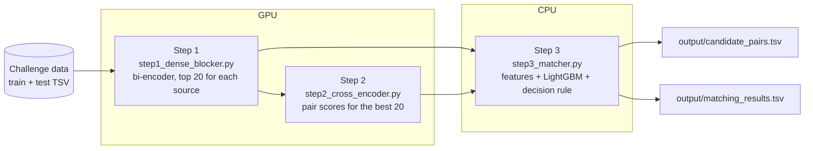

# Business Entity Resolution — pipeline of team COD-i

This folder contains the full pipeline. It reads the challenge data and writes the two submission files:

- `output/matching_results.tsv` — the final matches
- `output/candidate_pairs.tsv` — the candidate set that the matcher scores

The method is in `Documentation_template.md` (at the top of the ZIP). This file tells you how to run the code.

## 1. Pipeline



| Step | Script | Hardware | Result |
|---|---|---|---|
| 1 | `src/step1_dense_blocker.py` | GPU | 40 candidates for each Source 1 record (20 from Source 2, 20 from Source 3) |
| 2 | `src/step2_cross_encoder.py` | GPU | a cross-encoder score for the best 20 candidates of each Source 1 record |
| 3 | `src/step3_matcher.py` | CPU | features, LightGBM matcher, decision rule, the two TSV files, the official validator |

All models have an MIT or Apache-2.0 licence and fewer than 8 billion parameters (see section 8).
The pipeline uses only the challenge data. It does not use external data, an external service or an API.

## 2. Requirements

- Linux, Python 3.12.
- Step 1 and step 2: one or more CUDA GPUs with 12 GB of memory or more. More GPUs make the steps faster.
- Step 3: CPU only. 32 GB of RAM or more. 16 or more cores are recommended.
- Free disk space: 25 GB (feature store 9 GB, candidate files 3 GB, raw-data copies and caches).
- Internet access for the first run of step 1. It downloads `intfloat/multilingual-e5-small` from Hugging Face.

```bash
cd code/business_entity_resolution
python -m venv .venv && source .venv/bin/activate
pip install -r requirements.txt
```

`requirements.txt` installs the default PyTorch build. If your GPU needs a different CUDA build, install PyTorch
first from https://pytorch.org, then install the other packages.

## 3. Data

Put the challenge data in a folder with this structure:

```
dataset/
├── train/  train_source1.tsv  train_source2.tsv  train_source3.tsv  train_ground_truth.tsv
└── test/   test_source1.tsv   test_source2.tsv   test_source3.tsv
```

The scripts look for `dataset/` in these places: `code/business_entity_resolution/dataset`, then the folder that
contains `code/`, then the current folder. You can also give the folder with `--data-dir`.

## 4. Run

One command for the full pipeline:

```bash
bash run_pipeline.sh --data-dir /path/to/dataset
```

Or run the steps one at a time:

```bash
python src/step1_dense_blocker.py --data-dir /path/to/dataset    # GPU
python src/step2_cross_encoder.py --data-dir /path/to/dataset    # GPU
python src/step3_matcher.py       --data-dir /path/to/dataset    # CPU
```

Step 3 writes `matching_results.tsv` and `candidate_pairs.tsv` into the `output/` folder next to `code/`.
Then it runs the official validator (`utils/validate_submission.py` next to the dataset folder, or `--validator <path>`).

### Options that all steps have

| Option | Default | Function |
|---|---|---|
| `--data-dir` | see section 3 | folder that contains `train/` and `test/` |
| `--work-dir` | `code/business_entity_resolution/work` | intermediate files (see section 6) |
| `--out-dir` | `output/` next to `code/` | folder for the two TSV files |
| `--threads` | all CPUs of the process | CPU threads |

### If a run stops

Start the same command again. Each step keeps its finished parts on disk and does not do them again.
To do a finished part again, use `--force` (step 1, step 2) or delete its files in the work folder.

### Different machines for the steps

The GPU steps and the CPU step can run on different machines. Copy these files into the same work folder on the
CPU machine before step 3:

- `work/dense/dense_train.parquet`, `work/dense/dense_test.parquet`
- `work/ce/ce_dev.parquet`, `work/ce/ce_test_*.parquet` (37 files)

### Parallel runs for the test data

The test data has 37 chunks of 50,000 Source 1 records. Step 2 and step 3 can divide the chunks between runs:

```bash
python src/step2_cross_encoder.py --stage test --shard 0/2      # run 1 of 2
python src/step2_cross_encoder.py --stage test --shard 1/2      # run 2 of 2

python src/step3_matcher.py --stage dev                         # one time
python src/step3_matcher.py --stage test --shard 0/4            # four runs: 0/4, 1/4, 2/4, 3/4
python src/step3_matcher.py --stage finalize                    # after all test chunks have scores
```

All runs must use the same work folder, or you must copy their result files into one work folder.
On one machine, step 3 runs up to 12 chunks at the same time without this option (`--jobs` sets the number).

## 5. Time

Approximate times. Step 1, step 2 and the Kaggle row are from our runs. The 96-thread row is an estimate.

| Step | Machine | Time |
|---|---|---|
| 1 | 2 × T4 (Kaggle) | 2.5 h (training 40 min) |
| 2, train | 2 × RTX 5070 | 61 min |
| 2, development scores | 2 × RTX 5070 | 3 min |
| 2, test scores | 2 × RTX 5070 | approximately 90 min (5,300 to 8,900 pairs each second) |
| 3, `--stage dev` only | 4 CPU threads (Kaggle) | 1.2 h |
| 3, all stages | 96 CPU threads, 129 GB RAM | approximately 1 h to 1.5 h |

## 6. Files in the work folder

```
work/
├── cache/                    feature store (hashed token matrices, record keys) and the run cache
├── dense/                    step 1
│   ├── model/                the fine-tuned bi-encoder
│   ├── dense_train.parquet   s1_eid, t_eid, src, score, rank   (top 20 for each source, all training S1)
│   ├── dense_test.parquet    the same for the test S1
│   └── dense_report.json     recall of the candidates on S1 records that did not train the model
├── ce/                       step 2
│   ├── ce_model/             the fine-tuned cross-encoder
│   ├── ce_dev.parquet        s1_eid, t_eid, src, ce_logit      (development samples of the matcher)
│   ├── ce_test_<chunk>.parquet
│   └── ce_train_report.json, ce_dev_report.json
└── matcher/                  step 3
    ├── matcher.pkl           the LightGBM models, the feature list and the decision rule
    ├── scored_test_<chunk>.parquet     s1_eid, t_eid, src, p, accepted
    └── report_dev.json, report_test_*.json, report_finalize.json
```

`report_dev.json` contains the validation score of each matcher stage and the score on the outer holdout.

## 7. Source code

```
src/
├── step1_dense_blocker.py      step 1
├── step2_cross_encoder.py      step 2
├── step3_matcher.py            step 3
├── make_candidate_pairs.py     writes candidate_pairs.tsv from the step 1 result only (no matcher)
├── make_submission_zip.py      checks the two TSV files and makes the submission ZIP
└── ber/
    ├── settings.py             seed, K = 20, sample sizes, chunk size (step 2 and step 3 share these values)
    ├── paths.py, cli.py        folders and command-line options
    ├── normalize.py            text normalisation: transliteration, legal forms, street types, phonetic tokens
    ├── data.py, store.py       TSV -> parquet -> normalised views -> feature store
    ├── split.py, universe.py   label graph, component-disjoint splits, S1 samples, reverse evidence join
    ├── dense.py                reads the dense candidates; makes the reverse lists
    ├── features.py             pair features (string similarity, rare tokens, numbers, mutations, ranks)
    ├── graph.py                sibling-graph features (stage 3 of the matcher)
    ├── matcher.py              LightGBM stages, calibration, decision rules, emptiness gate
    ├── pipeline.py             inference for one test chunk
    ├── jobs.py, runcache.py    child processes for the heavy jobs; result cache on disk
    └── metrics.py              macro F0.5 and bootstrap confidence interval
```

To change a setting (for example the number of training records of the matcher), edit `src/ber/settings.py`.
Then run step 2 (`--stage dev --force`) and step 3 again. The two steps must use the same settings.

## 8. Models and licences

| Model | Use | Parameters | Licence |
|---|---|---|---|
| `intfloat/multilingual-e5-small` | step 1 bi-encoder; start weights of the step 2 cross-encoder | 118 million | MIT |
| LightGBM | step 3 matcher | gradient-boosted trees | MIT |

No other pre-trained model is used. No large language model is used.

## 9. Reproducibility

- The splits, the samples and the LightGBM models use fixed seeds (`settings.SEED`).
- Step 3 is deterministic for the same input files and the same number of threads.
- Step 1 and step 2 train neural networks on a GPU with mixed precision. A new training run gives a model that is
  almost equal, but not bit-identical. Thus a full run from the raw data gives output files that are almost equal to
  the submitted files, with small differences in a small number of rows.
- We made the submitted files with notebook versions of this same code (step 1 on Kaggle, step 2 and step 3 on
  rented machines). For this package we changed the notebooks into scripts and removed the code of experiments
  that the final pipeline does not use. We made sure that the package code and the notebook code give the same
  step 3 result (byte-identical output files) from the same input files.

## 10. Make the submission ZIP

```bash
python code/business_entity_resolution/src/make_submission_zip.py --team COD-i --test-dir /path/to/dataset/test
```

The script checks the two TSV files, runs the official validator and writes `COD-i_submission.zip` next to `code/`.
The work folder and the dataset are not put into the ZIP.
